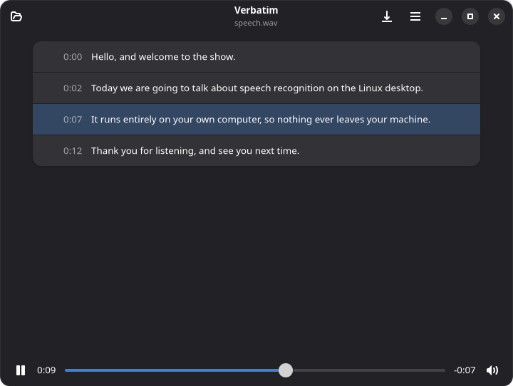

# Verbatim

> Transcribe audio files and caption live audio with local speech-to-text models

[](https://github.com/brpaz/verbatim/actions/workflows/ci.yml)
[](LICENSE.md)
[](https://flatpak.org)
[](#verbatim)

> [!WARNING]
> **AI usage notice:** this project was fully vibe coded with Claude Opus 5.5 to scratch a personal itch. The code has had little human review. Use it at your own risk, and check transcripts against the audio before relying on them.

<div align="center">



</div>

## Features

- Transcribes audio and video files on your computer: nothing is uploaded
- 25 European languages with NVIDIA Parakeet TDT v3, or about 100 with OpenAI Whisper Large v3 Turbo, which can be told the language
- Shows the transcript as it is recognised, and plays the file from any line
- Captions live audio from the microphone or from whatever the computer plays
- Saves the transcript as text, or as SRT or WebVTT subtitles

## Requirements

- **Linux** on x86_64 or aarch64.
- **Flatpak** works on any distribution, and brings everything else with it.
- **The .deb and .rpm packages** need GTK 4.20 and libadwaita 1.8 or newer: Ubuntu 25.10 or newer (including 26.04 LTS), Debian 14 or newer, Fedora 43 or newer, Arch or openSUSE Tumbleweed. Ubuntu 24.04, Debian 13 and Fedora 42 ship older versions; use the Flatpak there.
  - GStreamer with its base, good and PulseAudio plugins is installed as a dependency.
  - The GStreamer libav plugin (`gstreamer1.0-libav` on Debian and Ubuntu, `gstreamer1-plugin-libav` on Fedora) is recommended: it adds decoders for more formats, such as AAC and most video files.
- **Live captions** need PipeWire or PulseAudio, the default on current desktops.
- **Models** are downloaded once, after asking: about 670 MB for Parakeet, or 1 GB for Whisper.
- **Memory:** about 2 GB free while transcribing, with either model.
- **Speed:** on an AMD Ryzen 7 8845HS, using 8 threads, Parakeet transcribes about 12 times faster than real time and Whisper about 3 times. Live captions keep up with either.

## Install

Download the package for your system from the [latest release](https://github.com/brpaz/verbatim/releases/latest):

```bash
# Flatpak
flatpak install --user dev.brunopaz.Verbatim.flatpak
flatpak run dev.brunopaz.Verbatim

# Debian/Ubuntu
sudo apt install ./verbatim.deb

# Fedora
sudo dnf install ./verbatim.rpm
```

## Build from Source

```bash
git clone https://github.com/brpaz/verbatim
cd verbatim
task run
```

Full prerequisites, running tests, building the Flatpak/`.deb`/`.rpm`, and the Taskfile reference: [CONTRIBUTING.md](CONTRIBUTING.md).

## Contributing

See [CONTRIBUTING.md](CONTRIBUTING.md).

## Contributors

<a href="https://github.com/brpaz/verbatim/graphs/contributors">
  
</a>

## License

This repo is MIT licensed. See [LICENSE.md](LICENSE.md).
