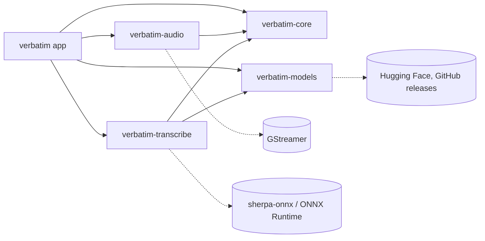

# Architecture

Verbatim is a GTK4 and libadwaita app in Rust that transcribes audio and video files, and captions live audio, with local speech recognition. Meson builds it around Cargo ([ADR 0002](adr/0002-build-with-meson-around-cargo.md)), and the UI is written in Blueprint ([ADR 0001](adr/0001-use-libadwaita-and-blueprint.md)).

## Workspace

```
├── src/                  # GTK app (crate `verbatim`)
│   ├── main.rs           # Logging, i18n, resources, application start
│   ├── application.rs    # AdwApplication: actions, accelerators, opening files
│   ├── window.rs         # Main window: file loading, live captions, transcript list, playback, export
│   ├── transcription.rs  # Background transcription job, for a file or live audio
│   ├── player.rs         # Audio playback for the media controls, on GStreamer `playbin`
│   ├── preferences.rs    # Preferences dialog: speech model and language
│   └── config.rs         # Build-time values from Meson (MESON_* variables)
├── crates/
│   ├── core/             # Domain types, Transcriber contract, TXT/SRT/WebVTT export
│   ├── models/           # Model catalog, verified resumable downloads
│   ├── audio/            # GStreamer file decoding and live capture to 16 kHz mono
│   └── transcribe/       # Silero VAD + Parakeet TDT or Whisper via sherpa-onnx
└── data/resources/ui/    # Blueprint UI definitions
```

`verbatim-core` depends on no audio, inference or UI library. The other crates implement or use its contracts, and the app wires them together.



## Transcribing a file

1. A file arrives from the Open dialog, a drop on the window, or the command line and "Open With" (`HANDLES_OPEN`).
2. The window loads it into a `Player`, a `GtkMediaStream` on GStreamer's `playbin` ([ADR 0009](adr/0009-play-files-with-playbin-instead-of-gtkmediafile.md)), and asks to download the models if any are missing ([ADR 0006](adr/0006-download-models-on-first-use.md)).
3. `transcription::Job` starts a thread ([ADR 0005](adr/0005-run-transcription-on-a-thread-in-the-app.md)) that:
   - installs missing models into `$XDG_DATA_HOME/verbatim/models`,
   - decodes the file with `verbatim_audio::Decoder`, a chunk at a time,
   - feeds 512-sample windows to Silero VAD, and each speech segment to the model chosen in Preferences: Parakeet ([ADR 0003](adr/0003-transcribe-with-parakeet-via-sherpa-onnx.md)) or Whisper with an optional fixed language ([ADR 0008](adr/0008-offer-whisper-as-an-alternative-model.md)); with Parakeet, a segment under 6 seconds is recognised after the last 3 seconds of the previous one, so it keeps the language, and the context's words are dropped by their timestamps,
   - sends each `Segment`, with its word timings, to the main loop as soon as it is recognised.
4. The window appends a row per segment. Activating a row seeks playback to it, and the row playing is kept selected.
5. When the job ends, the transcript can be copied or saved as text, SRT or WebVTT.

Opening another file cancels the running job. Each job has an id, and updates from a replaced job are dropped.

## Live captions

Live captions run through the same job and pipeline ([ADR 0007](adr/0007-caption-live-audio-by-re-decoding-speech-in-progress.md)):

1. "Live Captions" captures the source in the `live-source` setting, or the one picked from its menu: `pulsesrc` for the microphone, `pulsesrc device=@DEFAULT_MONITOR@` for system audio. Capture starts once the models are loaded.
2. The transcriber runs with partial results on (`SherpaTranscriber::with_partials`). It keeps the audio since the last finished segment, and while the VAD detects speech it re-decodes that audio every second (every 2 seconds with Whisper) and sends `Event::Partial`.
3. The window shows the partial text as a dimmed last row, replaced by the next partial or by the finished segment. The list follows new lines unless the user has scrolled back.
4. Stop sets the capture's stop flag. The stream then ends like a file, the VAD flushes, and the last speech becomes a final line.

## Subtitle cues

`verbatim_core::render` builds cues from word timings. A cue never spans two VAD segments, holds at most two lines of 42 characters, lasts at most 7 seconds, and ends at a sentence once it holds 24 characters. For segments without word timings (Whisper), word timings are estimated by spreading the segment's time over its words in proportion to their length.

## Models

| Model | Purpose | License |
|---|---|---|
| Silero VAD | Splits audio into speech segments | MIT |
| NVIDIA Parakeet TDT 0.6B v3 (int8) | Speech recognition, 25 European languages (default) | CC-BY-4.0 |
| OpenAI Whisper Large v3 Turbo (int8) | Speech recognition, about 100 languages, optional fixed language | MIT |

Only the chosen model is downloaded, together with the VAD.

The catalog in `crates/models` pins each file's URL to a commit, with its size and SHA-256. A model counts as installed when its files exist with the expected sizes. Checksums are verified once, at download.
